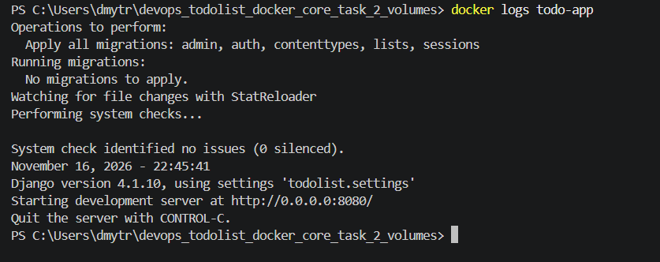

# Django ToDo App with MySQL

## Docker Hub Repositories

- Django App: https://hub.docker.com/r/dmytrotverdun/todoapp
- MySQL Database: https://hub.docker.com/r/dmytrotverdun/mysql-local

## Create Docker Network

```bash
docker network create todo-network
```

## Create Docker Volume

```bash
docker volume create todo-mysql-data
```

## Run MySQL Container

```bash
docker run -d --name todo-mysql --network todo-network -v todo-mysql-data:/var/lib/mysql dmytrotverdun/mysql-local:1.0.0
```

## Configure MySQL Connection

Find the IP address of the running MySQL container:

```bash
docker inspect -f '{{range .NetworkSettings.Networks}}{{.IPAddress}}{{end}}' todo-mysql
```

Open `todolist/settings.py` and update the `DATABASES` configuration.

Set `HOST` to the IP address returned by the command above.

Set `PORT` to an empty string to use the default MySQL port (3306).

Save the file before building the Django image.

## Build Django Image

Build the Docker image:

```bash
docker build -t dmytrotverdun/todoapp:2.0.0 .
```

Push the image to Docker Hub:

```bash
docker push dmytrotverdun/todoapp:2.0.0
```

## Run Django Container

The Django server is explicitly configured in the Dockerfile
to listen on port 8080 using:

```bash
python manage.py runserver 0.0.0.0:8080
```

Therefore, host port 8080 is mapped to container port 8080.

```bash
docker run -d --name todo-app --network todo-network -p 8080:8080 dmytrotverdun/todoapp:2.0.0
```

## Access the Application

Open the application in your browser:

http://localhost:8080

To access the ToDo list:

http://localhost:8080/todolist

## Application Startup Screenshot

