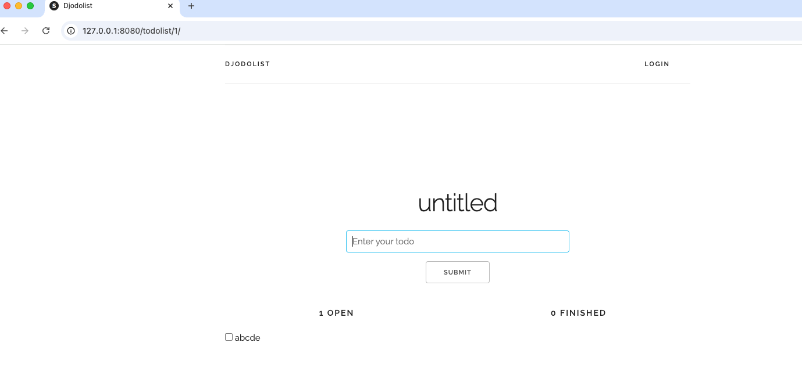

1.  Use to run MySQL container with a volume attached
    ```bash
    docker run -f Dockerfile.mysql -d -p 3306:3306 --name my-mysql -t mysql-local:1.0.0 -v my-mysql-data:/var/lib/mysql
    ```
2. Get running mysql server IP address and replace settings.py file
    ```bash
    docker network list
    docker network inspect bridge
    ```
3. Use to run App container
    ```bash
    docker run -d -p 8000:8000 --name todo-app -t todoapp:2.0.0
    ```

4. [LINK TO ACESS DOCKER HUB](https://hub.docker.com/repositories/kuznetsb)
5. Working app example
