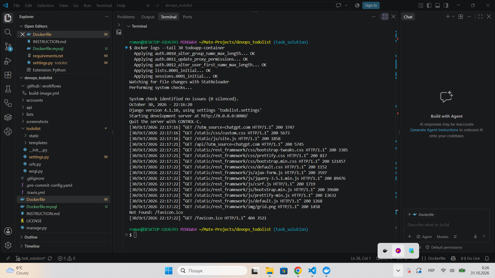
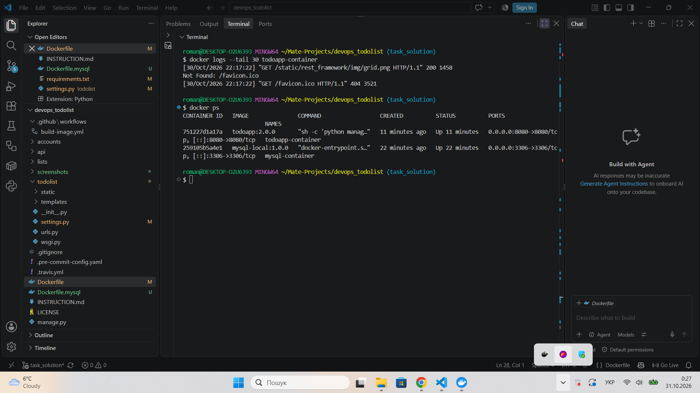
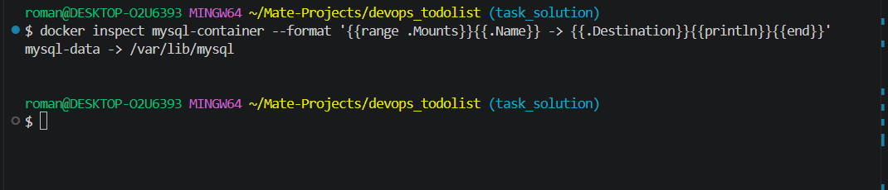

Django ToDo List — Docker and MySQL Volumes
Description
Django ToDo List is a task-management web application with user authentication and a REST API. This project runs Django and MySQL in separate Docker containers connected through a user-defined Docker network. MySQL data is stored in a named Docker volume so it persists when the MySQL container is removed and recreated.

This setup is intended for development and educational use.
Requirements
- Docker Desktop (running)
- Git
- Available host ports 8080 and 3306 (or use alternative host ports)
The Django image uses Python 3.11 and Django 4.1.10. The database image uses MySQL 8.0 and the application installs mysql-connector-python==8.2.0.
Docker Hub images
- Django: https://hub.docker.com/r/romanartem/todoapp — romanartem/todoapp:2.0.0
- MySQL: https://hub.docker.com/r/romanartem/mysql-local — romanartem/mysql-local:1.0.0
## 1. Clone the repository

git clone https://github.com/KoLpI76/devops_todolist_docker_core_task_2_volumes.git
cd devops_todolist_docker_core_task_2_volumes
git switch task_solution
## 2. Create the Docker network

Both containers must join the same network so Django can reach MySQL by container name.
docker network create todo-network
If the network already exists, reuse it instead of creating it again.

Verify:
docker network ls
## 3. Create the persistent MySQL volume

docker volume create mysql-data
Verify:
docker volume ls
The volume will be mounted at /var/lib/mysql inside the MySQL container.
## 4. Build the MySQL image

The Dockerfile.mysql is based on the official mysql:8.0 image. It configures the following development credentials:
Setting	Value
Database	app_db
Application user	app_user
Application password	1234
Root password	root1234
MySQL container port	3306

Build the image:
docker build -f Dockerfile.mysql -t mysql-local:1.0.0 .
Note: The sample credentials are embedded in the educational image and must not be reused for production. MySQL initialization variables apply only when the data directory is first initialized; an existing volume retains its existing database and credentials.
## 5. Start MySQL with the Docker volume

docker run -d \
  --name mysql-container \
  --network todo-network \
  -v mysql-data:/var/lib/mysql \
  -p 3306:3306 \
  mysql-local:1.0.0
If port 3306 is occupied on the host, use -p 3307:3306 instead. The internal MySQL port remains 3306.

Check the container and wait for MySQL to finish initialization:
docker ps
docker logs mysql-container
Look for ready for connections in the logs before starting Django.
## 6. Verify the database connection

docker exec -it mysql-container mysql -u app_user -p -D app_db
Enter 1234 when prompted. Inside the MySQL shell, run:
SHOW DATABASES;
EXIT;
The results should include app_db.
## 7. Verify the volume mount

docker inspect mysql-container --format '{{range .Mounts}}{{.Name}} -> {{.Destination}}{{println}}{{end}}'
Expected output:
mysql-data -> /var/lib/mysql
The volume preserves MySQL data when the container is removed. Do not remove mysql-data if you need to keep the database.
## 8. Django database configuration

The application uses the MySQL Connector/Python Django backend. The database configuration in todolist/settings.py is:
DATABASES = {
    "default": {
        "ENGINE": "mysql.connector.django",
        "NAME": "app_db",
        "USER": "app_user",
        "PASSWORD": os.environ.get("MYSQL_PASSWORD", "1234"),
        "HOST": os.environ.get("MYSQL_HOST", "mysql-container"),
        "PORT": "",
    }
}
The empty PORT setting uses the default MySQL port. Docker's todo-network resolves the hostname mysql-container to the MySQL container. The application and database must be on the same Docker network.
## 9. Build the Django image

The Django Dockerfile uses a multi-stage build to install Python dependencies and copy the application into a runtime image.
docker build -t todoapp-volumes:2.0.0 .
The image runs Django migrations at container startup, after MySQL is available, and then starts the Django development server on container port 8080.
## 10. Run the Django container

First, make sure mysql-container is running and ready. Then execute:
docker run -d \
  --name todoapp-volumes-container \
  --network todo-network \
  -p 8080:8080 \
  todoapp-volumes:2.0.0
If host port 8080 is already occupied, use -p 8081:8080 instead when creating the container, and open port 8081 in your browser. Do not run both commands with the same container name.
## 11. Verify Django startup

docker ps
docker logs todoapp-volumes-container
Successful startup includes messages similar to:
Operations to perform:
  Apply all migrations: admin, auth, contenttypes, lists, sessions
Running migrations:
  No migrations to apply.
System check identified no issues (0 silenced).
Starting development server at http://0.0.0.0:8080/
On a fresh database, Django will apply migrations rather than report No migrations to apply. Both are valid when no errors occur.
## 12. Open the application in a browser

With -p 8080:8080, open:
- Web application: http://localhost:8080/
- REST API: http://localhost:8080/api/
If you used -p 8081:8080, open:
- Web application: http://localhost:8081/
- REST API: http://localhost:8081/api/
A successful request to / returns HTTP status 200. If the application is not available, inspect the Django and MySQL logs and verify both containers are connected to todo-network.
## 13. Run using the published Docker Hub images

You can use the published images instead of building them locally:
docker pull romanartem/mysql-local:1.0.0
docker pull romanartem/todoapp:2.0.0
Create the network and volume using Steps 2–3, then start MySQL:
docker run -d \
  --name mysql-container \
  --network todo-network \
  -v mysql-data:/var/lib/mysql \
  -p 3306:3306 \
  romanartem/mysql-local:1.0.0
Wait until MySQL is ready, then start Django:
docker run -d \
  --name todoapp-volumes-container \
  --network todo-network \
  -p 8080:8080 \
  romanartem/todoapp:2.0.0
Then open http://localhost:8080/ in a browser. These commands assume containers with the specified names do not already exist; if they do, reuse them or stop and remove them before creating replacements.
## 14. Stop and restart the containers

Stop Django first, then MySQL:
docker stop todoapp-volumes-container
docker stop mysql-container
Restart MySQL first and wait until it is ready:
docker start mysql-container
docker logs mysql-container
Then restart Django:
docker start todoapp-volumes-container
## 15. Remove containers without deleting database data

docker stop todoapp-volumes-container mysql-container
docker rm todoapp-volumes-container mysql-container
The named volume mysql-data is retained. Recreate the MySQL container with -v mysql-data:/var/lib/mysql to reuse the database. Do not run docker volume rm mysql-data unless you intentionally want to delete the stored database.

## 16. Publish images to Docker Hub
docker login

docker tag mysql-local:1.0.0 romanartem/mysql-local:1.0.0
docker push romanartem/mysql-local:1.0.0

docker tag todoapp-volumes:2.0.0 romanartem/todoapp:2.0.0
docker push romanartem/todoapp:2.0.0
The published Django image was built from the working application configuration. If you modify the source, rebuild and republish the image before expecting Docker Hub to contain the changes.
## 17. Screenshots

### Django startup

### Running containers

### MySQL volume

## 18. Security and production notes
This setup is for development and educational purposes. For production use, provide credentials through secure secrets, disable Django DEBUG, configure ALLOWED_HOSTS, restrict access to MySQL, back up the volume, and use a production-grade application server.
