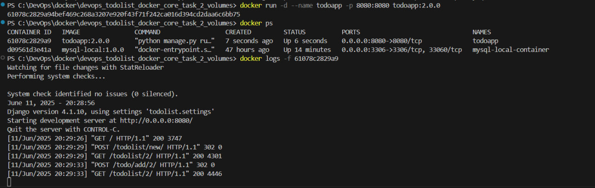

instuction for running container mysql:
   - build image by command: docker build . -f Dockerfile.mysql -t mysql-local:1.0.0
   - create and run container: docker run -d --name mysql-local-container -p 3306:3306 -v mysql-data:/var/lib/mysql mysql-local:1.0.0 
   - volume has been created by previous command

instruction for running APP container:
   - based on previous container you must extract IP address for future connection to db, for this follow the next step:
         * in terminal use command docker network inspect bridge and extract IP for mysql container
   - change config HOST in todolist/settings.py for connection to DB
   - build image: docker build . -f Dockerfile -t todoapp:2.0.0
   - create and run container > docker run -d --name todoapp -p 8080:8080 todoapp:2.0.0

start in browser http://localhost:8080/  in case you entered a different port when create container, change it to the appropriate port

My repository: [https://hub.docker.com/repository/docker/developer2020m](https://hub.docker.com/repositories/developer2020m)
