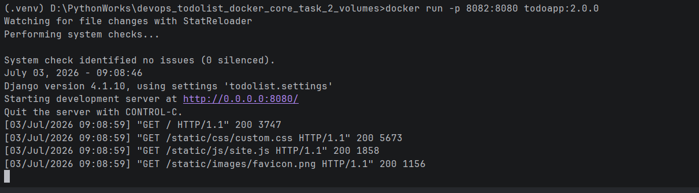

ToDo App Docker Instructions

MySQL image:
https://hub.docker.com/r/loki007777/mysql-local

Build image
docker build -f Dockerfile.mysql -t loki007777/mysql-local:1.0.0 .
Run container
docker run -d -p 8081:3306 -v mysqlvolume:/var/lib/mysql loki007777/mysql-local:1.0.0
Push image to Docker Hub
docker push loki007777/mysql-local:1.0.0

## Database configuration

The application uses MySQL as a database. The `DATABASES` block in `todolist/settings.py` should be configured as follows:

```python
DATABASES = {
    'default': {
        'ENGINE': 'mysql.connector.django',
        'NAME': 'app_db',
        'USER': 'app_user',
        'PASSWORD': '1234',
        'HOST': 'localhost',  # You can use a different host in your MySQL server is on a remote machine.
        'PORT': '',  # Leave this empty to use the default MySQL port (3306).
    }
}
```

App image:
https://hub.docker.com/r/loki007777/todoapp

Build image
docker build -t loki007777/todoapp:2.0.0 .
Run container
docker run -p 8080:8080 loki007777/todoapp:2.0.0
Push image to Docker Hub
docker push loki007777/todoapp:2.0.0


Open application
Open the application in your browser: http://localhost:8080

## Running application screenshot

